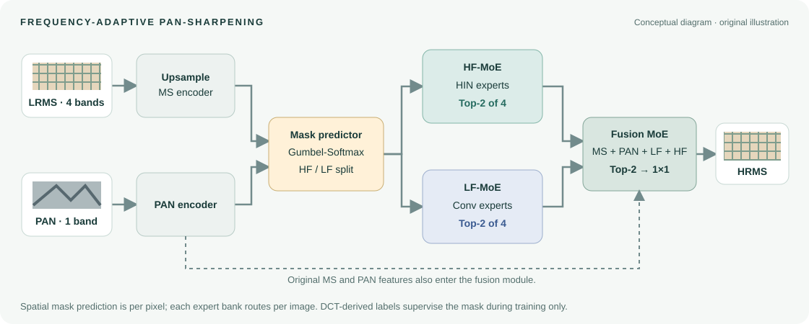

<div align="center">

# FAME-Net

### Frequency-Adaptive Pan-Sharpening with Mixture of Experts

**AAAI 2024 · Official implementation**

Xuanhua He\*, Keyu Yan\*, Rui Li, Chengjun Xie, Jie Zhang†, Man Zhou†

\* Equal contribution · † Corresponding authors

[AAAI Paper](https://doi.org/10.1609/aaai.v38i3.27984) · [arXiv](https://arxiv.org/abs/2401.02151) · [Project page](https://alexhe101.github.io/FAME-Net/) · [Modern documentation](modern/README.md)

[](https://github.com/alexhe101/FAME-Net/actions/workflows/famenet-modern.yml)

</div>



## Overview

FAME-Net reconstructs high-resolution multispectral images (HRMS) from low-resolution multispectral images (LRMS) and high-resolution panchromatic guidance (PAN). A learned spatial mask separates detail-rich and smoother regions; high- and low-frequency expert banks specialize in their reconstruction. A final top-k expert mixture combines both streams and the input features.

**FAME-Net Modern** is a paper-first reconstruction, not a blind refactor of the original public release. The original source remains unchanged. The default profile follows the paper's mask, routing, fusion and loss definitions; a separate legacy profile preserves the original active layer configuration for checkpoint migration, while fixing broken dispatch.

## Published results

Original AAAI 2024 Table 1, reduced-resolution Wald protocol:

| Sensor | PSNR ↑ | SSIM ↑ | SAM ↓ | ERGAS ↓ |
|:--|--:|--:|--:|--:|
| WorldView-II | 42.0262 | 0.9723 | 0.0215 | 0.9172 |
| GaoFen2 | 47.6721 | 0.9898 | 0.0098 | 0.5242 |
| WorldView-III | 30.9903 | 0.9287 | 0.0697 | 2.9531 |

| Method | WV2 PSNR ↑ | GF2 PSNR ↑ | WV3 PSNR ↑ |
|:--|--:|--:|--:|
| PanNet | 40.8176 | 43.0659 | 29.6840 |
| MSDCNN | 41.3355 | 45.6847 | 30.3038 |
| SRPPNN | 41.4538 | 47.1998 | 30.4346 |
| GPPNN | 41.1622 | 44.2145 | 30.1785 |
| MutNet | 41.6773 | 47.3042 | 30.4907 |
| INNformer | 41.6903 | 47.3528 | 30.5365 |
| SFINet | 41.7244 | 47.4712 | 30.5901 |
| FAME-Net | 42.0262 | 47.6721 | 30.9903 |

Full-resolution GaoFen2 (Table 2): Dλ = 0.0674, Ds = 0.1121, QNR = 0.8291. The original method leads PSNR on all three reduced-resolution datasets and QNR on GF2, but does not lead every metric. These are original published results, **not new measurements of the modern implementation**.

[](https://english.hf.cas.cn/nr/bth/202401/t20240110_655042.html)

Original qualitative comparison (paper Figure 5, also published by [HFIPS](https://english.hf.cas.cn/nr/bth/202401/t20240110_655042.html)); credit: Jie Zhang / HFIPS. The original labels and publication rights are retained. If the external image is unavailable, see [Figures 5–6 in the PDF](https://arxiv.org/pdf/2401.02151v1#page=7).

## Quick start

Python 3.10+ and PyTorch 2.4+. Install an appropriate PyTorch build for your device, then:

```bash
git clone https://github.com/alexhe101/FAME-Net.git
cd FAME-Net
python -m pip install -e './modern[dev]'
python -m pytest modern/tests -q -rs
```

```python
import torch
from famenet import FAMENet

model = FAMENet(bands=4, width=32, experts=4, top_k=2, scale=4).eval()
ms = torch.rand(1, 4, 32, 32)
pan = torch.rand(1, 1, 128, 128)

with torch.inference_mode():
    result = model(ms, pan)

print(result.hrms.shape)     # [1, 4, 128, 128]
print(result.mask.shape)     # [1, 2, 128, 128]
print(result.gates[0].shape) # [1, 4], full expert weight vector
```

Random inputs and weights demonstrate the API, not model quality. Use co-registered data with consistent band order and radiometric normalization.

```bash
# Train the paper-first model on your own paired data
famenet train --data train_npz --output runs/fame --device cuda --amp
famenet infer --checkpoint runs/fame/latest.pth --input sample.npz --output result.npz
# Import a historical checkpoint with the legacy profile
famenet infer --routing legacy --checkpoint legacy.pth --input sample.npz --output result.npz
# Compare actual sparse and dense execution (no assumed speedup)
famenet benchmark --device cuda --batch 4 --dispatch sparse
famenet benchmark --device cuda --batch 4 --dispatch dense
```

See [modern documentation](modern/README.md) for NPZ inputs, DCT-derived mask labels, paper/legacy differences and validation.

## Data and checkpoints

The original release does not provide its training datasets or trained weights. Prepare sensor-specific paired samples under the Wald protocol, matching the training radiometry, band order and spatial scale. Original experiments used WorldView-II, GaoFen2 and WorldView-III. The modern loader accepts explicit NPZ arrays and preserves all multispectral channels at output. Exact private mask-label thresholds and degradation settings are unavailable.

The old `main.py`, `test.py`, `model/` and `solver/` are preserved for historical reference; the release contains inconsistent expert dispatch and solver return contracts. Use the new CLI for new experiments. The new profile is a documented reconstruction and has not reproduced the original dataset metrics.

## Validation

[GitHub Actions](https://github.com/alexhe101/FAME-Net/actions/runs/45544297751): all 18 CPU tests passed on each of Python 3.10 and 3.12, including repaired legacy-reference parity and paper-router checks. These are synthetic regression tests, not a reproduction of the published image-quality metrics or a GPU speed benchmark.

## Repository layout

| Path | Purpose |
|:--|:--|
| [modern/src/famenet/](modern/src/famenet/) | Model, routing, checkpoint migration, losses, DCT labels, CLI |
| [modern/tests/](modern/tests/) | Numerical routing, checkpoint, legacy-reference, and training tests |
| [modern/README.md](modern/README.md) | Data contract and migration guide |
| [model/moe.py](model/moe.py) | Original published model (unchanged) |
| [docs/](docs/) | Static academic project page |

## Citation

```bibtex
@inproceedings{he2024fame,
  title     = {Frequency-Adaptive Pan-Sharpening with Mixture of Experts},
  author    = {He, Xuanhua and Yan, Keyu and Li, Rui and
               Xie, Chengjun and Zhang, Jie and Zhou, Man},
  booktitle = {Proceedings of the AAAI Conference on Artificial Intelligence},
  volume    = {38},
  number    = {3},
  pages     = {2121--2129},
  year      = {2024},
  doi       = {10.1609/aaai.v38i3.27984}
}
```
